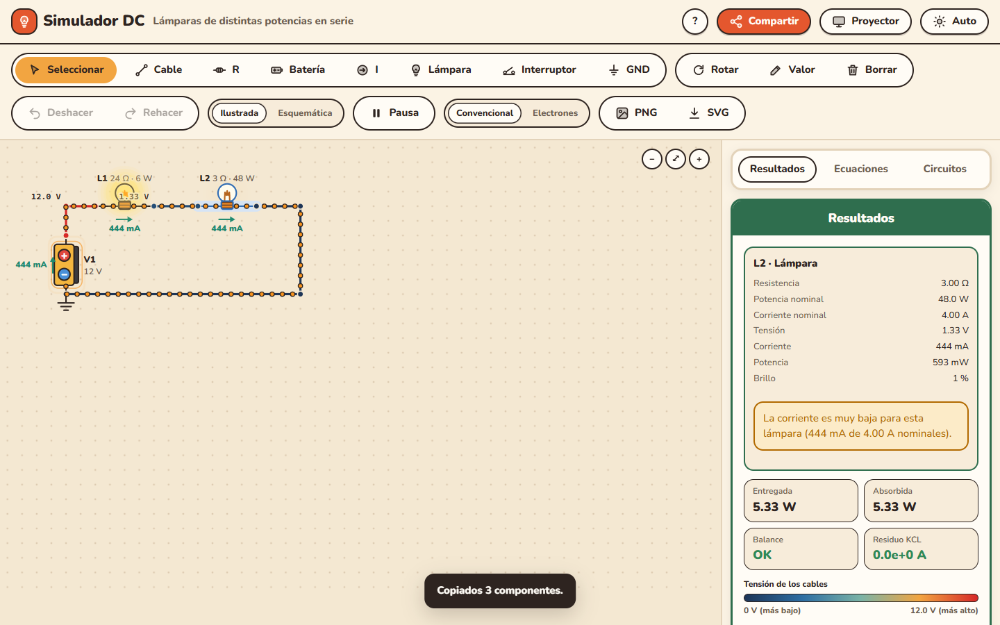
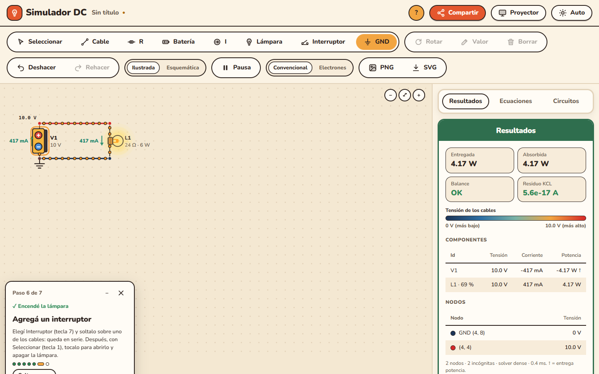
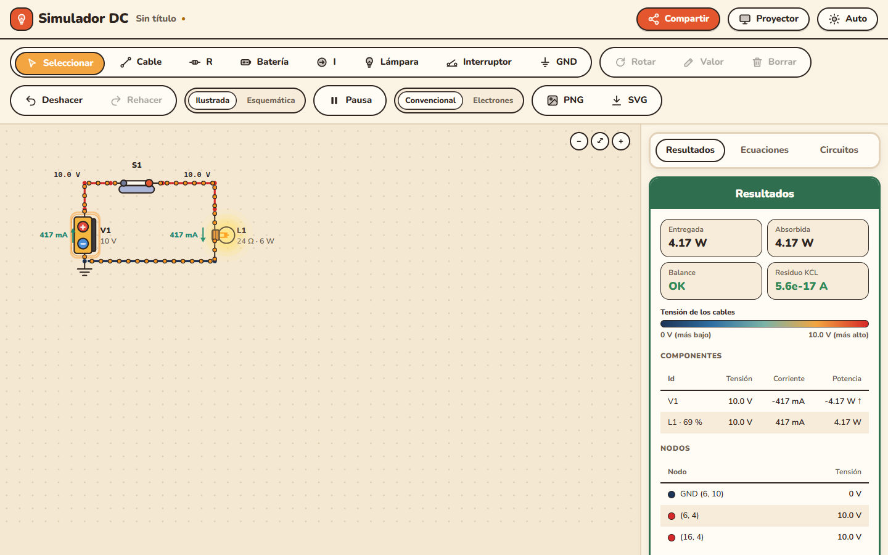
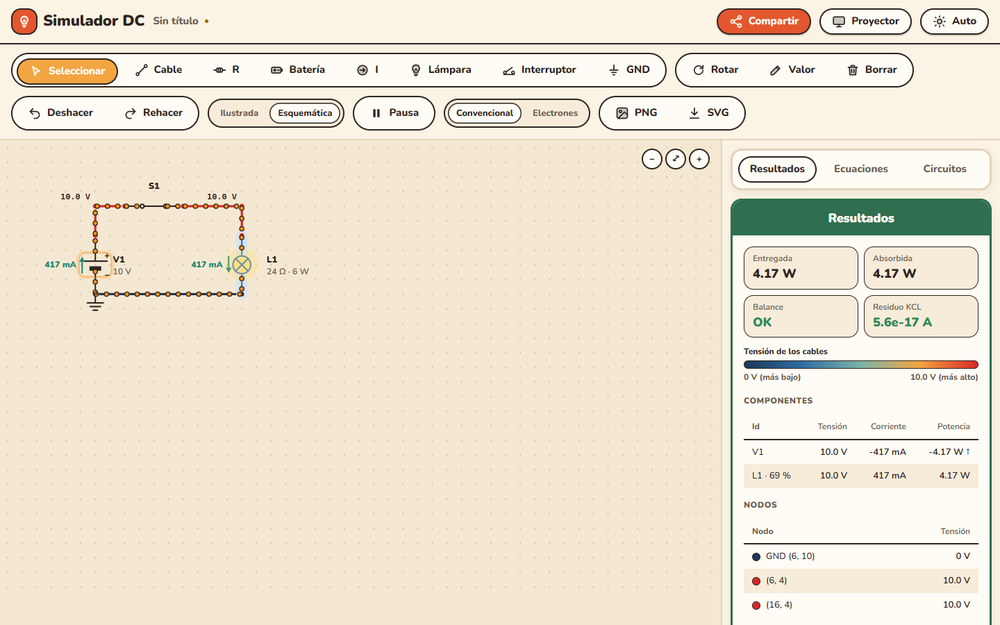

# Simulador DC

Un simulador de circuitos de corriente continua que funciona en el navegador. Dibujás el
circuito y ves al instante la tensión de cada nodo, la corriente y la potencia de cada componente,
el balance de potencias y las ecuaciones que lo resuelven.

**Abrilo acá: <https://vickysb23.github.io/Simulador-2.0/>**

No hay que instalar nada ni crear una cuenta. Funciona en la compu, la tablet y el celular, y
después de abrirlo una vez sigue funcionando **sin internet** (sirve para un aula sin wifi). Si
mientras está abierto se publica una versión nueva, abajo a la derecha aparece **"Hay una versión
nueva — Actualizar"**: con un clic se recarga con la versión nueva (el circuito abierto no se pierde).


---

## Armar un circuito en un minuto

1. **Arrastrá una pieza desde la barra** hasta el circuito: **R** (resistencia), **Batería**
   (fuente de tensión), **I** (fuente de corriente), **Lámpara**, **Interruptor** o **GND**
   (tierra). También podés tocarla (o usar su letra, ver los atajos) y hacer clic donde va; después
   de colocarla se vuelve sola a **Seleccionar**. Con la **barra espaciadora** se gira. Si la soltás
   **sobre un cable, queda en serie**: el cable se corta solo en sus bornes.
2. **Uní las piezas arrastrando desde un borne** hasta otro: el cable se dobla solo en L, y desde su
   punta se puede seguir dibujando. No hace falta elegir ninguna herramienta. Un cable seleccionado
   muestra sus puntas: arrastralas para estirarlo. Con la herramienta **Cable** (tecla **C**) cada
   clic agrega un tramo desde el anterior; **Esc** termina.
3. Dos terminales quedan conectados si caen en el mismo punto de la grilla o si los une un cable
   (un cable que termina en el medio de otro también se conecta).
4. **Poné la tierra** con **GND** en algún nodo. Sin tierra no hay referencia y el simulador lo avisa.
5. **Cambiá los valores** con **doble clic** sobre la pieza. Se aceptan prefijos: `10k`, `4.7k`
   (o `4,7k`), `1MEG`, `5m`, `2.2u`. `M` y `MEG` son mega; `m` es mili. La lámpara pide dos:
   su resistencia y su potencia nominal.
6. **Abrí o cerrá un interruptor** con un clic (con la herramienta Seleccionar).

Listo: los resultados aparecen solos mientras dibujás. Arrastrando una pieza la movés; con **Supr**
la borrás y con **Ctrl+Z** deshacés. El **clic derecho** sobre una pieza (o mantenerla presionada en
el celular) abre un menú para rotar, editar el valor, duplicar o borrar. Al pasar el mouse sobre
un cable o una pieza se ven su tensión y su corriente. Para acercar, usá la **rueda** (o dos dedos
en el celular); para mover la vista, **arrastrá el fondo vacío**.

Para trabajar con varias piezas a la vez, **Shift + arrastrar** sobre el fondo selecciona con un
rectángulo (**Ctrl + arrastrar** lo suma), y **Ctrl + clic** (o **Shift + clic**) suma o saca:
el grupo se mueve, gira (**R**) y se borra junto, y se copia con **Ctrl+C** / **Ctrl+V** o se
duplica con **Ctrl+D**. Con una sola pieza seleccionada, arriba de los resultados aparece su
**ficha**: valores, tensión, corriente, potencia y avisos.

Un componente con un borne al aire se marca **"sin conectar"** y no frena nada: por él no circula
corriente y el resto del circuito se sigue simulando.

**¿Primera vez?** El botón **?** del encabezado abre un tutorial corto, paso a paso: batería,
lámpara, cables, GND, encenderla, interruptor y quemarla. Cada paso espera a que lo hagas; se
puede saltear o cerrar.

¿Querés partir de algo hecho? En la pestaña **Circuitos → Ejemplos** hay trece circuitos de Física 2:

| Ejemplo | Qué muestra |
| --- | --- |
| Divisor de tensión | 12 V sobre 1 kΩ y 2 kΩ: el nodo del medio queda en 8 V |
| Serie | 1 kΩ, 2 kΩ y 3 kΩ con 12 V: circulan 2 mA y caen 2, 4 y 6 V |
| Paralelo | Las mismas resistencias en paralelo: 12 + 6 + 4 = 22 mA |
| Mixto (TP4) | (3 Ω ∥ 12 Ω) en serie con (6 Ω ∥ 4 Ω) con 60 V: V2 = 30 V, I = 12,5 A |
| Puente de Wheatstone | Equilibrado: no circula corriente por el galvanómetro (probá cambiar R4) |
| Dos mallas con dos fuentes | 12 V y 6 V con una rama común: el nodo del medio queda en 7,5 V y la fuente de 6 V absorbe potencia |
| Linterna | Pila de 6 V, interruptor y lámpara de 12 Ω / 3 W: 0,5 A, brillo pleno; con S1 abierto se apaga |
| Lámparas: serie contra paralelo | Dos lámparas iguales con 12 V: al 25 % en serie y al 100 % en paralelo |
| En serie se quema una y se apagan todas | Tres lámparas de 12 Ω con 18 V reciben 3 W; la de 2 W se quema y abre el circuito |
| En paralelo las demás siguen | Tres lámparas de 24 Ω con 12 V reciben 6 W; la de 4 W se quema y las otras siguen al 100 % |
| Dimmer con resistencia | 12 Ω en serie dejan la lámpara al 25 %; cerrando S1 se puentea y sube al 100 % |
| Lámparas de distintas potencias en serie | 6 W y 48 W con la misma corriente: 79 % y apenas 1 % (la ficha avisa que la corriente es baja) |
| Una casa con tres lámparas | Tres lámparas en paralelo, cada una con su interruptor: S2 abierto apaga solo la suya |

## Cómo leer los resultados

- **Color de los cables:** azul oscuro para la tensión más baja y rojo para la más alta (la
  leyenda está en Resultados). Al lado de cada nodo se ve su tensión respecto de tierra.
- **Puntos naranjas que avanzan:** la corriente, también por cada cable. Van más rápido cuanto
  más corriente hay (en escala logarítmica). El botón **Convencional / Electrones** cambia entre el
  sentido convencional (de + a −) y el flujo de electrones (de − a +); **Pausa** las detiene.
- **Flechas verdes:** el sentido real de la corriente en cada pieza, con su valor.
- **Lámparas:** brillan según la potencia que reciben respecto de la nominal. Si la superan, **se
  queman y abren el circuito**, como una real: en serie se apagan todas y en paralelo siguen las
  demás. Si una lámpara conectada brilla menos del 2 %, su ficha avisa: "La corriente es muy baja
  para esta lámpara (444 mA de 4.00 A nominales)". Las resistencias toman un brillo cálido según la potencia que disipan.
- **Fuentes:** la batería muestra **+** y **−** grandes y late cuando entrega energía; la fuente de
  corriente, una flecha con su sentido.
- **Vista ilustrada o esquemática:** el botón **Ilustrada / Esquemática** (o la tecla **V**) cambia
  entre los dibujos y los símbolos IEC de los libros.
- **Pestaña Resultados:** tensión, corriente y potencia de cada componente; tensión de cada nodo;
  potencia entregada y absorbida (tienen que ser iguales: **Balance OK**) y el residuo de la ley
  de Kirchhoff de corrientes (KCL), que debería ser prácticamente cero. Una potencia negativa (↑)
  significa que el componente **entrega** energía.
- **Pestaña Ecuaciones:** la ecuación de nodo (KCL) de cada nodo con los valores del circuito, la
  ecuación de cada fuente de tensión y el sistema del análisis nodal modificado (MNA), `A · x = z`,
  con la matriz completa y la solución. Sirve para mostrar en clase de dónde salen los números.


### Cuando algo está mal

El simulador no inventa números: si el circuito no tiene solución, explica por qué y marca en
rojo el lugar del problema.

| Mensaje | Qué pasa | Cómo se arregla |
| --- | --- | --- |
| Falta la tierra | No hay GND | Poné GND en un nodo |
| Nodos sin camino a tierra | Una parte cerrada del circuito no toca la tierra, o un nodo solo tiene una fuente de corriente | Conectala con una resistencia o una fuente de tensión (los nodos quedan marcados en rojo) |
| Lazo de fuentes de tensión | Dos fuentes de tensión en paralelo (o un lazo solo de fuentes) | Agregá una resistencia en el lazo |
| Fuente en cortocircuito | Un cable une los dos bornes de una fuente de tensión | Sacá el cable |
| La resistencia debe ser mayor que 0 Ω | Se cargó 0 o un valor negativo | Para un corto, usá un cable |

Una pieza con un borne al aire no es un error: se marca "sin conectar" y el resto sigue.










## Compartir un circuito

El botón **Compartir** (arriba a la derecha) copia un link que contiene el circuito completo:
piezas, posiciones, valores y tierra. Quien lo abra ve exactamente el mismo circuito y puede
modificarlo, sin cuenta y sin que el circuito pase por ningún servidor. Sirve para mandar un
ejercicio por el aula virtual o por WhatsApp.

## Guardar, exportar e imprimir

- **Guardar:** en **Circuitos → Guardar** el circuito queda en este navegador, con el nombre que
  elijas. Desde la lista se puede abrir, renombrar o borrar. Además, el último circuito abierto se
  recupera solo al volver a la página.
- **Exportar / Importar .json:** para llevar un circuito a otra compu o guardar una copia.
- **PNG y SVG** (en la barra de herramientas): descargan el dibujo del circuito, con sus resultados,
  para un apunte, una presentación o un examen. El SVG se puede agrandar sin perder calidad.


## Modo proyector

El botón **Proyector** (o la tecla **P**) agranda todo: el circuito, las letras, los botones y las
tablas, para que se lea desde el fondo del aula. El tema claro u oscuro se cambia con el botón de
al lado.


## Atajos de teclado

| Tecla | Acción |
| --- | --- |
| C, R, B, I, L, S, G | Cable, Resistencia, Batería, fuente de corriente (I), Lámpara, Interruptor (S), tierra (G) |
| Esc | Volver a Seleccionar (también termina un cable o cierra el menú) |
| 1 a 8 | Las mismas herramientas, en el orden de la barra |
| Espacio | Girar la pieza (la que vas a poner o lo seleccionado) |
| Shift + clic al colocar | Seguir con la misma herramienta |
| Clic derecho | Menú: rotar, editar valor, duplicar, borrar |
| Rueda | Zoom alrededor del puntero |
| Arrastrar el fondo | Mover la vista |
| Ctrl / Shift + clic | Sumar o sacar de la selección |
| Shift + arrastrar el fondo | Seleccionar con un rectángulo (Ctrl + arrastrar lo suma) |
| Ctrl+C / Ctrl+V / Ctrl+D | Copiar / pegar / duplicar lo seleccionado |
| Ctrl+A | Seleccionar todo |
| Doble clic | Editar el valor |
| Clic en un interruptor | Abrirlo o cerrarlo |
| V | Vista ilustrada / esquemática |
| Supr | Borrar lo seleccionado |
| Ctrl+Z / Ctrl+Y | Deshacer / rehacer |
| P | Modo proyector |

En el celular, todo se hace tocando: arrastrar desde la barra para poner una pieza, desde un borne
para dibujar un cable, una pieza para moverla y el fondo para mover la vista; dos dedos para el
zoom, doble toque para editar el valor y mantener presionado para el menú.


---

## Para quien quiera mirar el código

Página estática: HTML, CSS y JavaScript sin librerías ni paso de compilación, en `frontend/public/`.

- **Motor** (`js/lib/mna.js`): análisis nodal modificado. Los cables se unen con union-find (un cable
  ideal es un mismo nodo, no una resistencia diminuta). Antes de resolver se revisa la topología:
  tierra, nodos flotantes, lazos de fuentes de tensión y fuentes en corto. Resuelve con eliminación
  gaussiana densa hasta 200 incógnitas y dispersa por encima. Es un port del servicio en Python de
  la rama `microservicios`, con los mismos casos de prueba. Comparado contra ese servicio en 500
  circuitos aleatorios, dio los mismos errores en los 278 inválidos y una diferencia máxima de
  5,5·10⁻¹⁰ (relativa a la escala de cada circuito) en los 222 válidos
  ([`docs/comparacion/`](docs/comparacion/)).
- **Resto de la lógica sin DOM** (`js/lib/`): modelo del circuito, selección múltiple, ficha,
  pasos del tutorial, historial, valores, ejemplos,
  almacenamiento local, link para compartir, ecuaciones, corriente en cada cable (por KCL) y los
  cálculos de las animaciones. Tiene sus tests.
- **Diseño:** `css/tokens.css` (colores, tipografía Nunito incluida, radios y espaciados, en
  variantes clara, oscura y proyector) y una galería de todo el sistema en
  [`galeria.html`](https://vickysb23.github.io/Simulador-2.0/galeria.html). Las animaciones van en un
  canvas sobre el dibujo, para que ande fluido con 50 componentes en un celular.
- **Sin internet y actualizaciones:** `sw.js` guarda todos los archivos en una caché con versión.
  Pide primero a la red (HTML, JS y CSS, para no mezclar versiones) y usa la caché si no hay
  conexión o la red tarda más de 4 s. El workflow pone la versión (`simulador-dc-<hash del
  commit>`) al publicar: quien tenga la página abierta ve "Hay una versión nueva — Actualizar".

```bash
cd frontend && node --test          # tests (Node 22 o más nuevo, sin dependencias)
node tests/e2e/servir.mjs           # servidor local en http://localhost:8000/
```

Las pruebas en Chrome real están en [`tests/e2e/`](tests/e2e/README.md). Cada push a la rama `web`
corre los tests y publica `frontend/public/` en GitHub Pages
([`.github/workflows/pages.yml`](.github/workflows/pages.yml)).

**Historia:** empezó como una app de escritorio con Tkinter (rama `main`) y pasó por una versión en
microservicios con FastAPI, MongoDB, Consul y Traefik (rama `microservicios`). Esta versión
estática corre todo en el navegador.

Autora: Victoria Sanchez Bujaldon.
