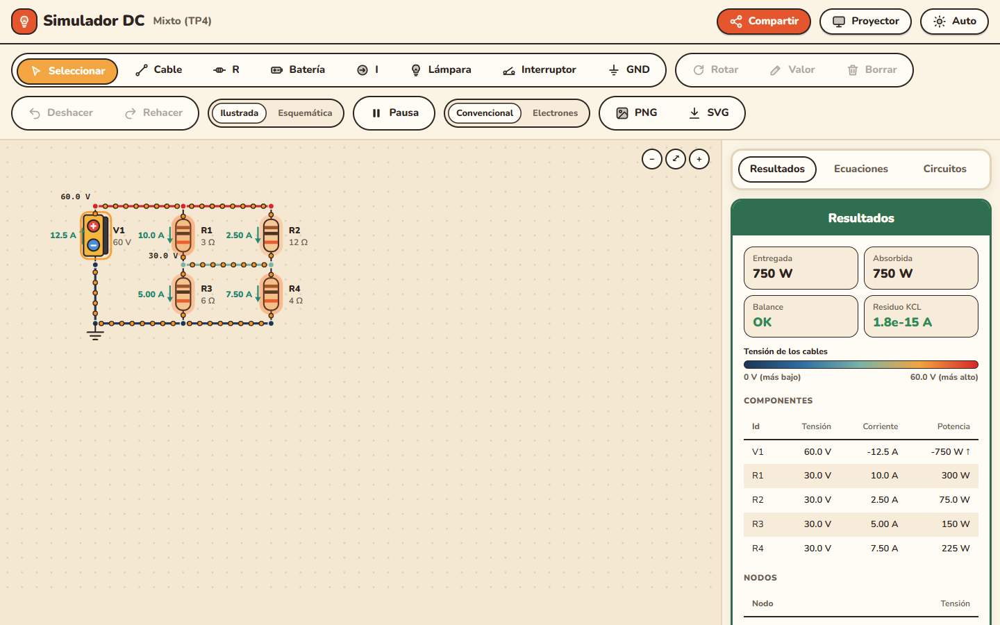
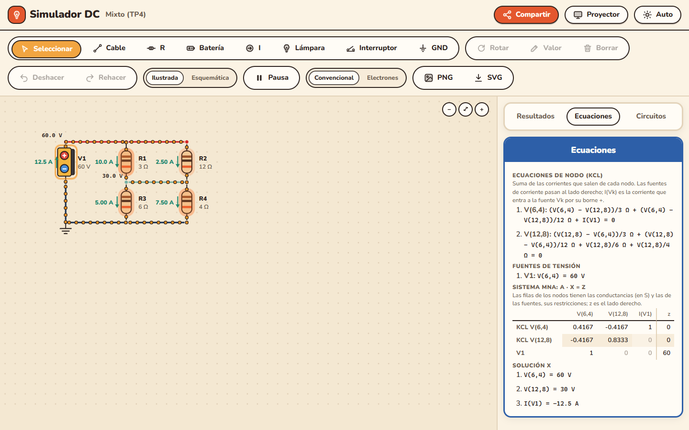
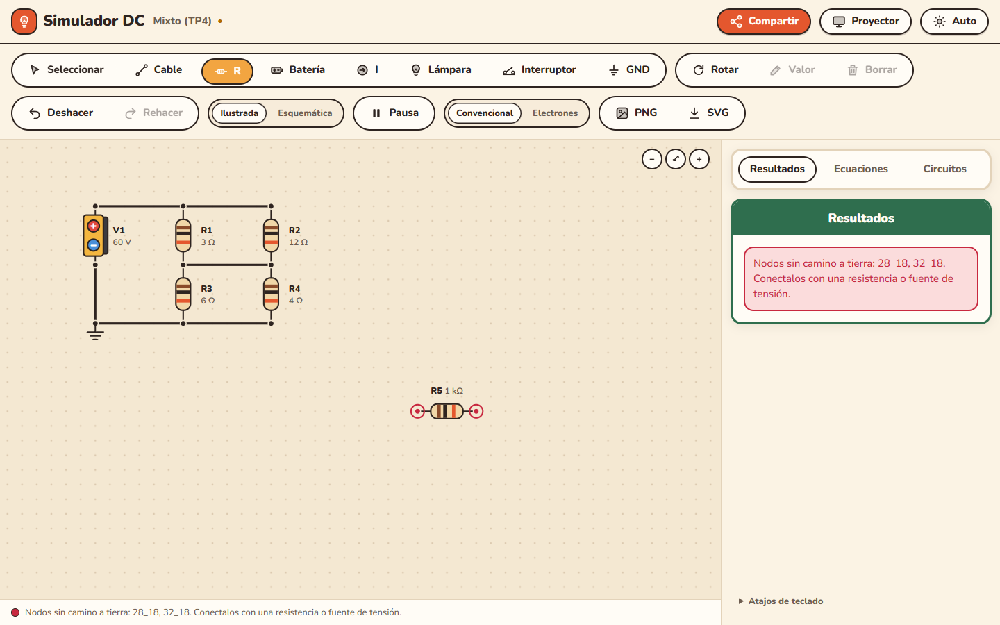
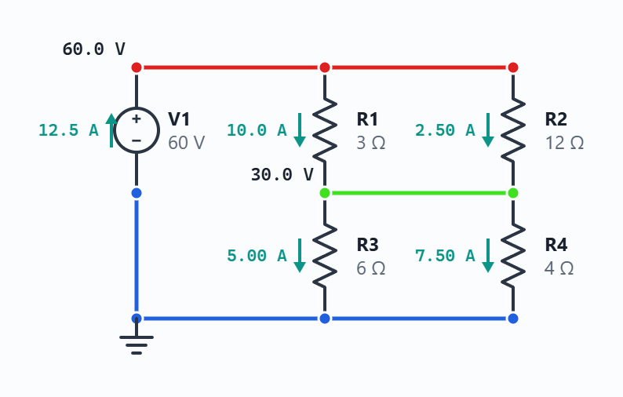
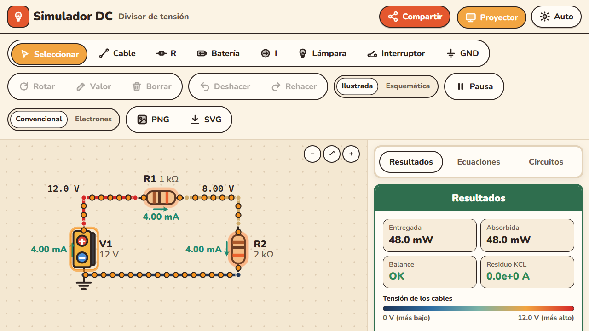
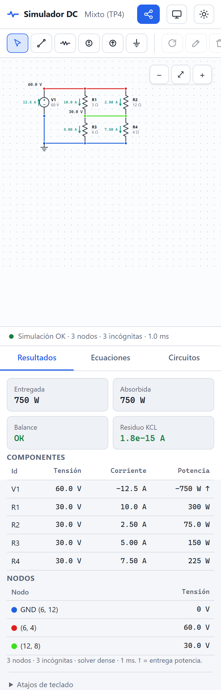

# Simulador DC

Un simulador de circuitos de corriente continua que funciona en el navegador. Dibujás el
circuito y ves al instante la tensión de cada nodo, la corriente y la potencia de cada componente,
el balance de potencias y las ecuaciones que lo resuelven.

**Abrilo acá: <https://vickysb23.github.io/Simulador-2.0/>**

No hay que instalar nada ni crear una cuenta. Funciona en la compu, la tablet y el celular, y
después de abrirlo una vez sigue funcionando **sin internet** (sirve para un aula sin wifi). Si
mientras está abierto se publica una versión nueva, abajo a la derecha aparece **"Hay una versión
nueva — Actualizar"**: con un clic se recarga con la versión nueva (el circuito abierto no se pierde).



---

## Armar un circuito en un minuto

1. **Elegí una herramienta** en la barra de arriba: **R** (resistencia), **V** (fuente de
   tensión), **I** (fuente de corriente), **Cable** o **GND** (tierra).
2. **Hacé clic en la grilla** para poner la pieza. Antes de hacer clic podés girarla con la tecla
   **R** o la **barra espaciadora**.
3. **Uní las piezas.** Dos terminales quedan conectados si caen en el mismo punto de la grilla o si
   los une un cable. Para el cable, arrastrá de un punto a otro (o hacé clic en el inicio y en el
   final).
4. **Poné la tierra** con **GND** en algún nodo. Sin tierra no hay referencia y el simulador lo avisa.
5. **Cambiá los valores** con **doble clic** sobre la pieza. Se aceptan prefijos: `10k`, `4.7k`
   (o `4,7k`), `1MEG`, `5m`, `2.2u`. `M` y `MEG` son mega; `m` es mili.

Listo: los resultados aparecen solos mientras dibujás. Con **Seleccionar** podés mover piezas
(arrastrando), borrarlas (**Supr**) o deshacer (**Ctrl+Z**).

¿Querés partir de algo hecho? En la pestaña **Circuitos → Ejemplos** hay seis circuitos de Física 2:

| Ejemplo | Qué muestra |
| --- | --- |
| Divisor de tensión | 12 V sobre 1 kΩ y 2 kΩ: el nodo del medio queda en 8 V |
| Serie | 1 kΩ, 2 kΩ y 3 kΩ con 12 V: circulan 2 mA y caen 2, 4 y 6 V |
| Paralelo | Las mismas resistencias en paralelo: 12 + 6 + 4 = 22 mA |
| Mixto (TP4) | (3 Ω ∥ 12 Ω) en serie con (6 Ω ∥ 4 Ω) con 60 V: V2 = 30 V, I = 12,5 A |
| Puente de Wheatstone | Equilibrado: no circula corriente por el galvanómetro (probá cambiar R4) |
| Dos mallas con dos fuentes | 12 V y 6 V con una rama común: el nodo del medio queda en 7,5 V y la fuente de 6 V absorbe potencia |

## Cómo leer los resultados

- **Color de los nodos y cables:** azul para la tensión más baja y rojo para la más alta. Al lado
  de cada nodo se ve su tensión respecto de tierra.
- **Flechas verdes:** el sentido real de la corriente en cada pieza, con su valor.
- **Fuentes:** la de tensión muestra su **+** y su **−**; la de corriente, una flecha con su sentido.
- **Pestaña Resultados:** tensión, corriente y potencia de cada componente; tensión de cada nodo;
  potencia entregada y absorbida (tienen que ser iguales: **Balance OK**) y el residuo de la ley
  de Kirchhoff de corrientes (KCL), que debería ser prácticamente cero. Una potencia negativa (↑)
  significa que el componente **entrega** energía.
- **Pestaña Ecuaciones:** la ecuación de nodo (KCL) de cada nodo con los valores del circuito, la
  ecuación de cada fuente de tensión y el sistema del análisis nodal modificado (MNA), `A · x = z`,
  con la matriz completa y la solución. Sirve para mostrar en clase de dónde salen los números.



### Cuando algo está mal

El simulador no inventa números: si el circuito no tiene solución, explica por qué y marca en
rojo el lugar del problema.

| Mensaje | Qué pasa | Cómo se arregla |
| --- | --- | --- |
| Falta la tierra | No hay GND | Poné GND en un nodo |
| Nodos sin camino a tierra | Una parte del circuito quedó suelta, o un nodo solo tiene una fuente de corriente | Conectala con una resistencia o una fuente de tensión (los nodos quedan marcados en rojo) |
| Lazo de fuentes de tensión | Dos fuentes de tensión en paralelo (o un lazo solo de fuentes) | Agregá una resistencia en el lazo |
| Fuente en cortocircuito | Un cable une los dos bornes de una fuente de tensión | Sacá el cable |
| La resistencia debe ser mayor que 0 Ω | Se cargó 0 o un valor negativo | Para un corto, usá un cable |



## Compartir un circuito

El botón **Compartir** (arriba a la derecha) copia un link que contiene el circuito completo:
piezas, posiciones, valores y tierra. Quien lo abra ve exactamente el mismo circuito y puede
modificarlo, sin cuenta y sin que el circuito pase por ningún servidor. Sirve para mandar un
ejercicio por el aula virtual o por WhatsApp.

## Guardar, exportar e imprimir

- **Guardar:** en **Circuitos → Guardar** el circuito queda en este navegador, con el nombre que
  elijas. Desde la lista se puede abrir, renombrar o borrar. Además, el último circuito abierto se
  recupera solo al volver a la página.
- **Exportar / Importar .json:** para llevar un circuito a otra compu o guardar una copia.
- **PNG y SVG** (en la barra de herramientas): descargan el dibujo del circuito, con sus resultados,
  para un apunte, una presentación o un examen. El SVG se puede agrandar sin perder calidad.



## Modo proyector

El botón **Proyector** (o la tecla **P**) agranda todo: el circuito, las letras, los botones y las
tablas, para que se lea desde el fondo del aula. El tema claro u oscuro se cambia con el botón de
al lado.



## Atajos de teclado

| Tecla | Acción |
| --- | --- |
| 1 a 6 | Seleccionar, Cable, R, V, I, GND |
| R o espacio | Girar la pieza (la que vas a poner o la seleccionada) |
| Doble clic | Editar el valor |
| Supr | Borrar lo seleccionado |
| Ctrl+Z / Ctrl+Y | Deshacer / rehacer |
| Esc | Cancelar el cable o deseleccionar |
| P | Modo proyector |

En el celular, todo se hace tocando: un toque para poner o seleccionar, arrastrar para mover y
doble toque para editar el valor.



---

## Para quien quiera mirar el código

Página estática: HTML, CSS y JavaScript sin librerías ni paso de compilación, en `frontend/public/`.

- **Motor** (`js/lib/mna.js`): análisis nodal modificado. Los cables se unen con union-find (un cable
  ideal es un mismo nodo, no una resistencia diminuta). Antes de resolver se revisa la topología:
  tierra, nodos flotantes, lazos de fuentes de tensión y fuentes en corto. Resuelve con eliminación
  gaussiana densa hasta 200 incógnitas y dispersa por encima. Es un port del servicio en Python de
  la rama `microservicios`, con los mismos casos de prueba. Comparado contra ese servicio en 500
  circuitos aleatorios, dio los mismos errores en los 278 inválidos y una diferencia máxima de
  5,5·10⁻¹⁰ (relativa a la escala de cada circuito) en los 222 válidos
  ([`docs/comparacion/`](docs/comparacion/)).
- **Resto de la lógica sin DOM** (`js/lib/`): modelo del circuito, historial, valores, ejemplos,
  almacenamiento local, link para compartir y ecuaciones. Tiene sus tests.
- **Sin internet y actualizaciones:** `sw.js` guarda todos los archivos en una caché con versión.
  Pide primero a la red (HTML, JS y CSS, para no mezclar versiones) y usa la caché si no hay
  conexión o la red tarda más de 4 s. El workflow pone la versión (`simulador-dc-<hash del
  commit>`) al publicar: quien tenga la página abierta ve "Hay una versión nueva — Actualizar".

```bash
cd frontend && node --test          # tests (Node 22 o más nuevo, sin dependencias)
node tests/e2e/servir.mjs           # servidor local en http://localhost:8000/
```

Las pruebas en Chrome real están en [`tests/e2e/`](tests/e2e/README.md). Cada push a la rama `web`
corre los tests y publica `frontend/public/` en GitHub Pages
([`.github/workflows/pages.yml`](.github/workflows/pages.yml)).

**Historia:** empezó como una app de escritorio con Tkinter (rama `main`) y pasó por una versión en
microservicios con FastAPI, MongoDB, Consul y Traefik (rama `microservicios`). Esta versión
estática corre todo en el navegador.

Autora: Victoria Sanchez Bujaldon.
